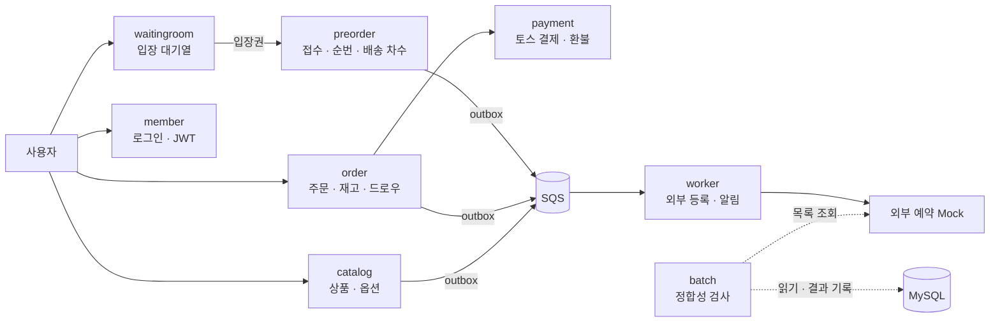
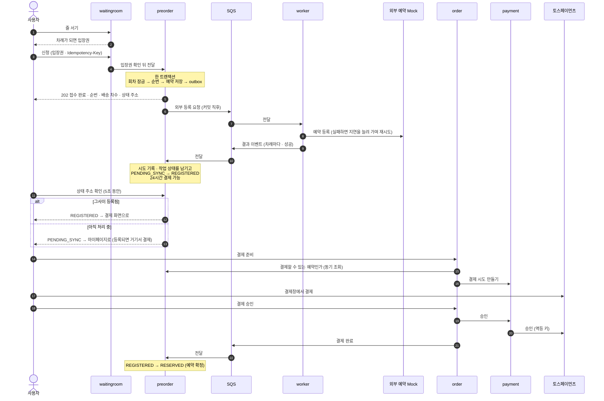
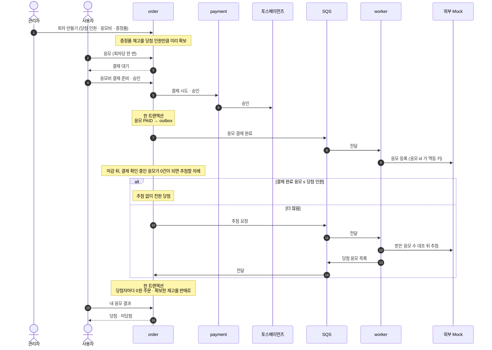

# NOVA

**전자기기 사전예약 서비스의 백엔드.** 오픈 순간 신청이 몰려도 한 건도 잃지 않고 받고, 럭키 드로우(추첨 응모)도 함께 운영한다.

신청은 저장되면 바로 `202 Accepted` 로 답한다. 느리고 가끔 실패하는 외부 예약 시스템 등록은 그 뒤에 백그라운드에서 처리한다.
서버가 중간에 죽었다 살아나도 접수된 예약은 사라지지 않고 이어서 처리된다. 자동 재시도로도 끝나지 않는 건은 관리자가 확인해 재처리한다.

---

## 어떤 문제를 푸나

인기 전자기기 사전예약이 열리면 몇 초 만에 수천 명이 몰린다. 이때 세 가지가 동시에 어렵다.

1. **몰림** — 10초에 5,000건이 들어와도 순서를 지키고, 같은 사람이 두 번 접수되지 않아야 한다.
2. **느린 외부 시스템** — 예약은 외부 시스템에 등록돼야 확정되는데, 이 시스템은 평균 500ms 걸리고 5% 는 실패한다.
3. **장애** — 처리 중에 서버가 죽어도 예약이 사라지거나 외부에 두 번 등록되면 안 된다.

NOVA 는 이 문제를 하나의 구분으로 푼다.

> **접수 완료 ≠ 외부 등록 완료**
>
> "접수 완료"는 신청을 안전하게 저장했다는 뜻이다. 외부 등록이 끝났다는 뜻이 아니다.
> 그래서 외부 시스템을 기다리지 않고 바로 답하고, 외부 호출이 한 번 실패해도 예약이 실패한 것으로 보지 않는다.

사용자 화면은 접수 뒤 5초 동안 결과를 지켜본다. 그사이 외부 등록이 끝나면 바로 결제로 넘어가고,
아직이면 마이페이지로 보낸다. 등록이 끝나면 마이페이지에서 결제할 수 있다.

```
신청 ─▶ 202 접수 완료 · 순번 안내 ─┬─ 5초 안에 외부 등록 확인 ─▶ 결제 ─▶ 예약 확정
                                   └─ 아직 처리 중 ─▶ 마이페이지 ─▶ 등록되면 결제 ─▶ 예약 확정
```

## 주요 기능

**사용자**

- 카카오 로그인
- 입장 대기열 — 오픈 순간 몰린 사람을 줄 세워 차례로 들여보낸다
- 사전예약 신청 · 처리 상태 · 순번 · 배송 차수 · 결제 · 취소
- 럭키 드로우 — 응모비를 결제하고 응모, 당첨되면 상품을 0원 주문으로 받는다
- 일반 판매 상품 주문 · 장바구니 · 토스페이먼츠 결제 · 환불
- 상품 리뷰

**관리자**

- 상품 · 옵션 등록과 편집, 사전예약 회차와 배송 차수 설정
- 예약 · 실패 내역 조회, 처리하지 못한 메시지(DLQ) 확인과 재처리
- 대기열 입장 속도 조절
- 럭키 드로우 회차 만들기 · 응모와 추첨 진행 확인

## 전체 구조



- 서비스는 모두 Spring Boot 이고 AWS ECS Fargate 위에서 따로 돈다. DB 는 NCP 의 MySQL 이다.
- 서비스끼리는 HTTP(묻기)나 SQS 이벤트(알리기)로만 이야기한다.
- 외부 예약 시스템은 팀이 만든 Mock 이 대신한다. 별도 저장소([Grandis-2/mock](https://github.com/Grandis-2/mock))에 있고 우리와는 HTTP 로만 통신한다.

## 두 가지 흐름

### 사전예약



### 럭키 드로우



사전예약의 worker 구간은 동작한다. 럭키 드로우의 worker 구간(응모 등록 · 추첨)은 아직 구현 중이라,
그림은 서비스 사이 계약([`contracts/draw-entry-sync.md`](contracts/draw-entry-sync.md))에 정해 둔 동작이다.

## 핵심 설계

### 1. 같은 사람이 두 번 접수되지 않는다 — 락이 아니라 유니크 키로

"모델당 1인 1매"는 애플리케이션 코드가 아니라 DB 가 지킨다.
진행 중인 예약에만 값이 있는 칸(`active_marker`)을 두고 `(회원, 모델, active_marker)` 에 유니크 키를 건다.
동시에 두 건이 들어와도 하나는 반드시 막힌다. 취소된 예약은 이 칸이 비어서 다시 신청할 수 있다.

### 2. 같은 요청을 다시 보내도 결과는 하나 — 멱등키

클라이언트는 신청마다 `Idempotency-Key` 를 보낸다.

- 같은 키로 같은 내용을 다시 보내면 → 새 예약을 만들지 않고 기존 결과를 돌려준다.
- 같은 키로 다른 내용을 보내면 → 거절하고 무엇이 달랐는지 알려준다.

그래서 응답을 못 받고 새로고침해도 원래 예약을 다시 찾을 수 있고, 순번이 두 번 소비되지 않는다.

### 3. 모델마다 1번부터 빈틈없는 순번 — 회차 행 잠금

순번은 모델마다 따로 1번부터 센다. 접수할 때 그 모델의 회차 행을 잠그고(`SELECT … FOR UPDATE`) 다음 번호를 가져간다.
잠금은 모델 단위라서 다른 모델의 신청과는 서로 기다리지 않는다. 마지막 방어선으로 `(모델, 순번)` 유니크 키도 건다.

배송 차수는 이 순번으로 정한다. 관리자가 "1~1,000번은 1차"처럼 구간을 정하고, 순번이 속한 구간이 곧 배송 차수다.
**외부 등록이 끝난 순서와는 상관이 없다.**

### 4. 저장과 발행을 한 트랜잭션에 — Transactional Outbox

접수 트랜잭션 안에서 예약 · 이력 · 외부 등록 작업 · 발행할 이벤트를 함께 저장한다.
이벤트는 커밋 직후 SQS 로 보내고, 못 보낸 것은 릴레이가 다시 집어 보낸다.
"예약은 저장됐는데 메시지는 사라짐", 혹은 그 반대가 생기지 않는다.

### 5. 실패는 다시 시도하고, 끝내 안 되면 사람이 본다 — 재시도 · DLQ

worker 는 DB 를 쓰지 않는다. 외부에 보낼 내용과 몇 번째 시도인지를 메시지에 싣고 다니며,
실패하면 지연을 늘려 가며(+지터) 같은 큐에 다시 보낸다. 차례마다 결과를 이벤트로 알리면 preorder 가 시도 기록과 작업 상태를 남긴다.
정해진 횟수를 다 쓰면 포기(DEAD_LETTER)로 기록하고 관리자가 확인 · 재처리한다.
**포기로 기록된 것 자체를 예약 실패로 보지 않는다.**

외부에 두 번 등록되지 않도록, 예약 하나에 등록 작업은 하나만 만들고(유니크 키), 재시도마다 접수 때 고정한 같은 요청과 같은 멱등 키를 보낸다.
결과가 불분명하면 다시 등록하지 않고 같은 키로 먼저 조회한다.

### 6. 오픈 순간의 몰림은 대기열이 받는다 — waitingroom

접수는 회차 행 잠금과 DB 커넥션을 쓰기 때문에 한 번에 받을 수 있는 양에 한계가 있다. 그래서 그 앞에 대기열을 두고 들어오는 속도를 조절한다.

- 줄은 Redis 정렬 집합(ZSET)에 서고, 줄 서기 · 입장 판정은 Lua 스크립트로 한 번에 처리한다.
- 차례가 되면 HMAC 서명 입장권을 받는다. preorder 는 저장소를 조회하지 않고 서명만 확인한다.
- 여러 모델이 동시에 열려도 리더 하나가 전체 입장 속도를 모델별로 나눠 준다.

### 7. 추첨은 한 번, 빠진 응모 없이 — 럭키 드로우

- 응모는 회원마다 회차당 하나다. 동시에 두 번 눌러도 유니크 키가 하나만 남긴다.
- 회차를 만들 때 증정품 재고를 당첨 인원만큼 미리 확보한다. 당첨됐는데 줄 물건이 없는 일이 생기지 않는다.
- 추첨은 마감 뒤 결제 확인 중인 응모가 모두 끝난 다음에 한다. 추첨 직전에는 외부 Mock 이 받은 응모 수를 우리 쪽 결제 완료 수와 대조하고,
  다르면 추첨을 미룬다. 추첨 뒤에는 빠진 응모를 되돌릴 수 없기 때문이다.
- 서버가 여러 대여도 회차 행 잠금과 "요청함 · 반영함" 표식으로 추첨과 결과 반영은 회차마다 한 번이다.

### 8. 트랜잭션이 서비스 경계를 정했다

한 트랜잭션에 묶여야 하는 것은 한 서비스 안에 둔다.

```
접수        회차 잠금 → 순번 → 예약 저장 → 이력 → outbox           preorder 안에서 끝난다
결제 성공    주문 전이 + 재고 held→sold + 장바구니 차감              order 안에서 끝난다
```

재고와 장바구니가 catalog 가 아니라 order 에 있는 이유다. catalog 에 두면 결제 성공이 분산 트랜잭션이 된다.
worker(메시지가 오면 깨어나고 1~20대로 늘어남)와 batch(시간이 되면 깨어나고 1대로 고정)는 늘어나는 방식이 정반대라 나눴다.

## 기술 스택

| 영역 | 사용 |
| --- | --- |
| 언어 · 프레임워크 | Java 25 · Spring Boot 4.1 · Spring Data JPA · Spring Cloud Gateway(WebFlux) |
| 저장소 | MySQL 8.4 (`READ COMMITTED`, NCP) · Redis |
| 메시징 | AWS SQS (Transactional Outbox) |
| 인증 | 카카오 OAuth · JWT RS256 (JWKS 로 공개키 배포) · 리프레시 토큰 회전 |
| 결제 | 토스페이먼츠 |
| 회복 · 캐시 | Resilience4j · Caffeine |
| DB 변경 | Flyway (Docker CLI) |
| 테스트 | JUnit 5 · Testcontainers · ArchUnit · k6 |
| 관측 | Micrometer · Prometheus · OpenTelemetry Java 에이전트 |
| 배포 | GitHub Actions · Amazon ECR · ECS Fargate · JVM AOT 캐시 |

## 모듈 구성

| 모듈 | 하는 일 | 상태 |
| --- | --- | --- |
| `member` | 카카오 로그인 · JWT 발급 · 회원 · 기본 배송지 | 동작 |
| `catalog` | 상품 · 옵션 · 리뷰 · 관리자 등록/편집 | 동작 |
| `waitingroom` | 입장 대기열 — 줄 서기 · 입장권 · 접수 전달 | 동작 |
| `preorder` | 사전예약 접수 · 순번 · 회차 · 배송 차수 · 취소 · 외부 작업 원장 · DLQ 관리 | 동작 |
| `order` | 주문 · 재고 · 장바구니 · 드로우 | 동작 |
| `payment` | 토스 결제 · 결제 원장 · 복구 · 환불 (내부 전용) | 동작 |
| `worker` | SQS 를 받아 외부 예약 등록 · 취소, 드로우 응모 · 추첨, 알림 (DB 없음) | 예약 등록 · 취소 동작, 드로우 · 알림 구현 중 |
| `batch` | 정합성 검사 — 우리 DB 와 Mock 원장(목록 조회 API)을 대조해 결과를 남긴다 · 안 쓰는 사진 정리 | 골격 — 구현 중 |
| `common:*` | 서비스가 함께 쓰는 라이브러리 (응답 · 보안 · outbox · SQS · Redis 등) | — |

<details>
<summary>서비스별로 소유한 표</summary>

| 서비스 | 표 |
| --- | --- |
| `member` | `customers` · `refresh_tokens` |
| `catalog` | `categories` · `products` · `product_options` · `product_reviews` · `catalog_outbox_events` · `images` |
| `preorder` | `preorders` · `preorder_events` · `preorder_campaigns` · `shipment_batches` · `preorder_outbox_events` · `dead_letter_events`<br>`preorder_sync_jobs` · `preorder_sync_attempts` (외부 작업 · 시도 원장) |
| `order` | `orders` · `order_items` · `order_events` · `cart_items` · `option_inventories` · `draw_campaigns` · `draw_entries` |
| `payment` | `payments` · `payment_transactions` |
| `worker` | (없음 — DB 를 쓰지 않는다. 결과는 이벤트로 preorder 에 알린다) |
| `batch` | `reconciliation_runs` · `reconciliation_findings` (정합성 검사 결과. 업무 표는 읽기만) · `image_deletions` (사진 정리의 S3 삭제 대기) |
| `waitingroom` | (없음 — 전용 Redis) |

표는 소유한 서비스만 쓴다. 다른 서비스의 데이터는 그 서비스의 API 로 묻는 것이 원칙이고,
예외는 목록 화면의 페이징 조건처럼 쿼리 안에 있어야 하는 읽기뿐이다.
쓰기 예외는 둘이다 — 정합성 검사 결과는 preorder 도 쓴다(관리자 화면 API 가 preorder 에 있어, `reconciliation_runs` 에 실행 요청을 넣고 `reconciliation_findings` 의 조치 칸을 바꾼다). 정리 배치(`batch`)는 `images` 의 오래된 `UNUSED` 행(아무 데도 안 붙은 사진)과 그 S3 객체를 지운다.
표 사이 관계는 [ERD](https://dbdiagram.io/d/Copy-of-Untitled-Diagram-6aa66499957fec6d5bdd9189)에 있다.

</details>

## 로컬에서 실행하기

**필요한 것**: JDK 25, Docker, 로컬 MySQL 8.4(`shop` 스키마) · Redis

```sh
# 1. SQS 에뮬레이터(Floci)를 띄우고 큐를 만든다
docker compose -f docker/floci/compose.yaml up -d

# 2. DB 스키마를 만든다 (Flyway 는 컨테이너로 돈다. 자세한 건 스키마 · Flyway 안내)
FLYWAY_URL=jdbc:mysql://host.docker.internal:3306/shop FLYWAY_USER=... FLYWAY_PASSWORD=... \
  bash flyway-project/flyway.sh migrate

# 3. 서비스마다 설정 예시를 복사하고 CHANGE_ME 를 채운다
cp member/src/main/resources/application.yml.example member/src/main/resources/application.yml

# 4. 서비스를 띄운다
./gradlew :member:bootRun
```

| 서비스 | 포트 |
| --- | --- |
| member | 8080 |
| catalog | 8082 |
| preorder | 8083 |
| order | 8084 |
| waitingroom · payment | 8085 (둘을 함께 띄울 때는 하나를 바꾼다) |

API 문서는 Swagger 허브(`docker/openapi-hub`)로 member · catalog · preorder · order 를 한곳에 모아 볼 수 있다.

## 더 읽을거리

- [ERD](https://dbdiagram.io/d/Copy-of-Untitled-Diagram-6aa66499957fec6d5bdd9189) — 표 · 관계 · 칸 설명 (기준: 2026-10-11 dev)
- [스키마 · Flyway 안내](flyway-project/README.md) — DB 를 바꾸는 절차
- [`contracts/`](contracts) — 서비스 사이 API · 이벤트 계약
- [기여 방법](CONTRIBUTING.md) — 브랜치 · 커밋 규칙
